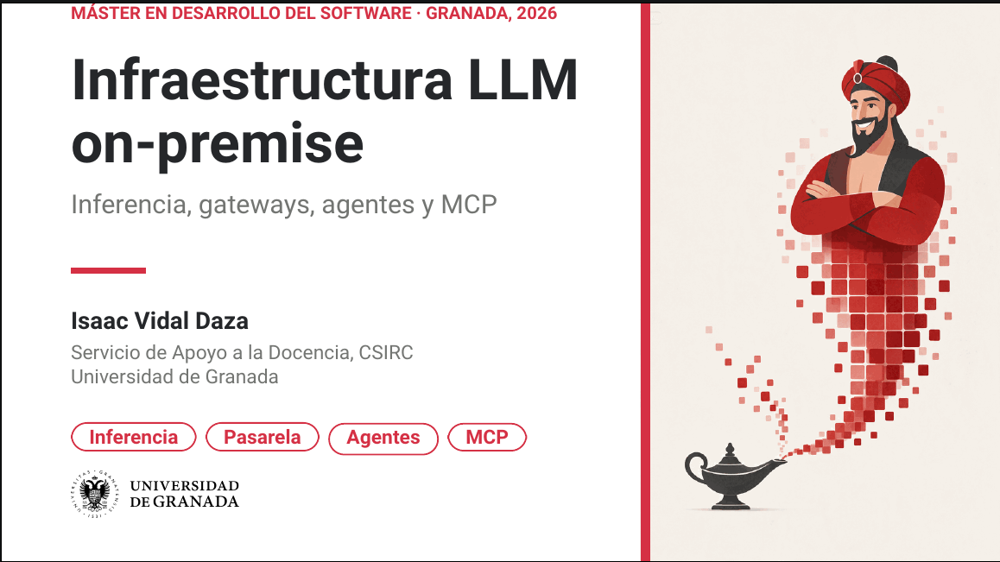

# MiIA-demo

Materiales del seminario sobre infraestructura LLM *on-premise* del Máster en
Desarrollo del Software de la Universidad de Granada. El repositorio reúne la
presentación y una demostración práctica para aprender sobre inferencia,
pasarelas, agentes, herramientas y MCP.

## Tabla de contenidos

- [Recursos](#recursos)

## Recursos

- [Presentación en PDF](presentación/presentacion.pdf) y [fuentes LaTeX](presentación/presentacion.tex).
- [Demostración con Docker](miia-demo/README.md): instalación, configuración y uso.
- [Ejemplos y guía](miia-demo/ejemplos/README.md): de la API a los agentes.
