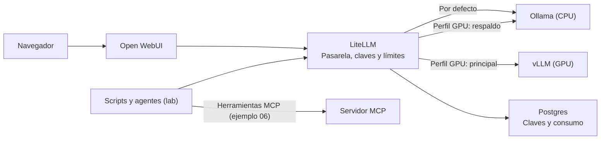

# MiIA-demo · una infraestructura LLM on-premise en miniatura

Un `docker compose` que levanta, en tu portátil y **sin GPU**, las mismas piezas que una
infraestructura LLM institucional, y una serie de scripts que acompañan la charla.



Ollama también puede usar una GPU NVIDIA mediante la configuración opcional
descrita en [Ollama con GPU NVIDIA](#ollama-con-gpu-nvidia).

## Requisitos

- Docker con Compose v2.
- ~8 GB de RAM libres y ~7 GB de disco (imágenes de Docker + modelo de ~1,9 GB).
- Opcional: GPU NVIDIA con NVIDIA Container Toolkit para el perfil `gpu`.

### Instalar Docker (si aún no lo tienes)

Aunque existen otros métodos (como instalar solo Docker Engine), para equipos
personales Docker Desktop suele ser la opción más simple porque incluye motor,
interfaz gráfica y herramientas de terminal en una sola instalación.

#### macOS

1. Descarga Docker Desktop desde la
  [web oficial](https://www.docker.com/products/docker-desktop/), eligiendo
  Apple Silicon (M1/M2/M3/M4) o Intel según tu equipo.
2. Abre el `.dmg`, arrastra Docker a `Aplicaciones` y ejecuta Docker Desktop.
3. Acepta los términos y concede permisos cuando macOS los solicite.

#### Windows

Requisitos mínimos recomendados (según Docker):

- Windows 10 de 64 bits (22H2+) o Windows 11 de 64 bits (23H2+).
- 8 GB de RAM y virtualización por hardware activada.
- WSL 2 activo (versión 2.1.5 o superior).

Pasos:

1. Si no tienes WSL 2, abre PowerShell como administrador y ejecuta
  `wsl --install`.
2. Descarga `Docker Desktop Installer.exe` desde la
  [documentación oficial](https://docs.docker.com/desktop/setup/install/windows-install/)
  y ejecuta el instalador (manteniendo WSL 2).
3. Completa el asistente, reinicia si se pide e inicia Docker Desktop.
4. Acepta el acuerdo de suscripción para arrancar el motor.

#### Linux

Docker Desktop dispone de paquetes para Ubuntu, Debian, Fedora y Arch
(requiere virtualización KVM). Consulta la
[guía oficial para Linux](https://docs.docker.com/desktop/setup/install/linux/).

Ejemplo en Ubuntu/Debian:

```bash
sudo apt-get update
sudo apt-get install ./docker-desktop-amd64.deb
systemctl --user start docker-desktop
```

Comprobación final (en cualquier sistema):

```bash
docker run hello-world
```

## Antes de la charla (importante)

Descargar imágenes y modelo con una red compartida es lento. Hazlo **antes**:

```bash
docker compose pull
docker compose build
docker compose up -d        # la primera vez, ollama-init descarga el modelo (~1,9 GB)
docker compose logs -f ollama-init
```

### Error de DNS al construir las imágenes

Si `pip install` falla con `Temporary failure in name resolution`, comprueba si el
anfitrión puede acceder a PyPI con `curl -I https://pypi.org/simple/mcp/`. Si funciona
en el anfitrión pero falla durante la construcción, en Linux puedes probar la red del
anfitrión para construir `mcp` y `lab`, por ejemplo si usas una VPN:

```bash
export MIIA_BUILD_NETWORK=host
docker compose build mcp
docker compose --profile lab build lab  # si vas a usar los scripts del laboratorio
docker compose up -d
```

La variable solo cambia la red de construcción, no la red de los contenedores en
ejecución. Si también fallan sus descargas (por ejemplo, la del modelo de Ollama),
hay que revisar el DNS, la VPN o el proxy de Docker. Para volver a la configuración
por defecto, ejecuta `unset MIIA_BUILD_NETWORK`. En Docker Desktop u otros
constructores, la red `host` puede no estar disponible o funcionar de otra forma;
consulta su configuración de red y proxy.

## Arranque rápido

```bash
docker compose up -d
```

| Qué | Dónde |
|---|---|
| Chat (Open WebUI) | http://localhost:3000 |
| Panel de LiteLLM (claves, consumo, modelos) | http://localhost:4000/ui — usuario `admin`, contraseña `admin` |
| API compatible con OpenAI | http://localhost:4000/v1 — clave `sk-demo-master` |
| Servidor MCP | http://localhost:8001/mcp |

Comprobación:

```bash
curl -s http://localhost:4000/v1/chat/completions \
  -H "Authorization: Bearer sk-demo-master" -H "Content-Type: application/json" \
  -d '{"model":"miia-demo","messages":[{"role":"user","content":"Hola, ¿quién eres?"}]}'
```

## Ejemplos: de la API al agente

La carpeta [ejemplos/](ejemplos/) contiene seis programas que puedes recorrer
en orden: comienzan con una petición al modelo y terminan con agentes, MCP y
peticiones concurrentes. La [guía de ejemplos](ejemplos/README.md) explica los
conceptos y el funcionamiento de cada programa paso a paso.

Con los servicios arrancados y el modelo descargado, ejecuta los comandos desde
la raíz del proyecto. El contenedor `lab` incluye las bibliotecas necesarias y se
elimina al terminar; la primera ejecución puede tener que construir su imagen:

```bash
docker compose run --rm lab python ejemplos/01_hola_api.py
```

| Ejemplo | Qué aprenderás | Guía y código |
|---|---|---|
| 01 · API y streaming | Enviar mensajes, recibir fragmentos y medir TTFT y tokens/s. | [Explicación](ejemplos/README.md#01--peticiones-y-streaming) · [Código](ejemplos/01_hola_api.py) |
| 02 · Concurrencia | Lanzar varias peticiones a la vez y medir el rendimiento agregado. | [Explicación](ejemplos/README.md#02--concurrencia) · [Código](ejemplos/02_concurrencia.py) |
| 03 · Salida estructurada | Comparar JSON solicitado en texto con una respuesta sujeta a un esquema. | [Explicación](ejemplos/README.md#03--extraer-información-como-json) · [Código](ejemplos/03_salida_estructurada.py) |
| 04 · Tool calling | Ver cómo el modelo solicita una función y la aplicación la ejecuta. | [Explicación](ejemplos/README.md#04--una-llamada-a-herramienta-paso-a-paso) · [Código](ejemplos/04_tool_calling.py) |
| 05 · Agente local | Encadenar herramientas para leer archivos y crear un informe con una skill. | [Explicación](ejemplos/README.md#05--agente-con-archivos-permisos-y-skills) · [Código](ejemplos/05_agente_minimo.py) |
| 06 · Agente MCP | Descubrir herramientas de un servidor y utilizarlas desde el agente. | [Explicación](ejemplos/README.md#06--agente-con-herramientas-descubiertas-por-mcp) · [Código](ejemplos/06_agente_mcp.py) |

### Configuración y precauciones

Todos los ejemplos leen [config.json](ejemplos/config.json): por defecto usan
LiteLLM local, el modelo `miia-demo` y temperatura `0.0`. Puedes cambiar la URL,
el modelo, la temperatura y la clave para utilizar una API compatible con OpenAI.
Consulta [cómo configurar la API](ejemplos/README.md#configurar-la-api) y pasar
la clave mediante una variable de entorno; no guardes claves reales en el archivo.

Con una API externa, los mensajes y resultados de herramientas enviados al modelo
salen de tu equipo y pueden generar costes. Revisa las políticas del proveedor y
comparte solo datos autorizados. Además, no todos los proveedores soportan todas
las funciones utilizadas por estos ejemplos.

El ejemplo 05 solicita permiso antes de crear o sobrescribir archivos en
[workspace/](workspace/), salvo que se use `--auto`. El ejemplo 06 puede añadir
tickets a `workspace/tickets.jsonl`. Las respuestas del modelo son variables:
revisa siempre tanto el contenido generado como las acciones realizadas.

### Comprobar los ejemplos

Para comprobar todos los scripts con los servicios ya arrancados:

```bash
bash test-scripts.sh
```

La prueba usa un sandbox y un servidor MCP temporales para no escribir informes ni
tickets en `workspace`. Comprueba los resultados esenciales y devuelve un código
distinto de cero si alguna prueba falla. Por defecto limita cada script a 300 segundos;
puedes ajustarlo, por ejemplo, con `TEST_TIMEOUT=600 bash test-scripts.sh`.
Las respuestas de los agentes dependen del modelo y pueden variar entre ejecuciones.
En la tarea predeterminada del agente 04 se comprueba que haya cargado la skill
`informe-incidencias` y escrito `informe.md`; si no lo consigue o se deniega el
permiso de escritura, termina con error en lugar de dar la tarea por completada.

Al terminar, si no vas a seguir usando la demo, puedes parar y eliminar sus
contenedores con `docker compose down`. Consulta [Limpieza](#limpieza) para saber
qué datos se conservan y cómo eliminar también los volúmenes.

## Trabajar con OpenCode o Claude Code

El proyecto incluye la skill [`miia-demo`](.claude/skills/miia-demo/SKILL.md):
un conjunto de instrucciones que ayuda al asistente a orientarse en esta demo,
responder dudas y realizar cambios teniendo en cuenta sus pruebas y precauciones.
Es distinta de la skill `informe-incidencias` que utiliza el agente del ejemplo 05.

Instala y configura [OpenCode](https://opencode.ai/) o
[Claude Code](https://code.claude.com/), incluido el acceso al modelo que quieras
utilizar. Desde la raíz de este proyecto, inicia uno de ellos:

```bash
opencode
# o bien
claude
```

La skill está en `.claude/skills/`, una ubicación de proyecto que ambos productos
pueden descubrir. En Claude Code puedes invocarla escribiendo, por ejemplo:

```text
/miia-demo Explícame cómo pasa una petición desde el ejemplo 04 hasta Ollama.
```

En OpenCode pide al asistente que **use la skill `miia-demo`**, seguida de tu
pregunta o tarea. Por ejemplo: «Usa la skill miia-demo para explicarme el agente
del ejemplo 05» o «Usa la skill miia-demo para añadir una prueba de configuración».
También pueden seleccionarla automáticamente si la consideran pertinente. Una
pregunta no requiere modificar archivos; para un cambio, describe el resultado
esperado y revisa los cambios y las pruebas antes de aceptarlos.

El asistente puede leer archivos del proyecto y enviarlos al proveedor del modelo
configurado. Usar una skill o un índice local **no** garantiza que el modelo sea
local: revisa el proveedor, sus costes y políticas, y no compartas credenciales
ni datos que no estés autorizado a enviar.

### Codebase Memory MCP: un mapa del código

Recomendamos [codebase-memory-mcp](https://github.com/DeusData/codebase-memory-mcp)
para ayudar al asistente a orientarse. Es un servidor MCP que analiza el proyecto
y construye un índice local en forma de grafo: por ejemplo, relaciona archivos,
funciones y llamadas. Así el asistente puede buscar dónde se implementa una
función o qué otras partes la utilizan antes de leer los archivos concretos.
Es como un mapa del código, no una copia del razonamiento del modelo ni una
garantía de que una respuesta o un cambio sea correcto.

No es el servidor MCP de herramientas de la demo (`mcp/`): funciona aparte y
se conecta al asistente de programación. El índice persiste localmente y puede
quedar desactualizado tras modificar o renombrar archivos; pide al asistente que
compruebe su estado y lo actualice cuando sea necesario. Conviene verificar
siempre los resultados contra los archivos actuales.

El proyecto incluye la configuración para Claude Code en [`.mcp.json`](.mcp.json)
y para OpenCode en [`opencode.json`](opencode.json). Para utilizarlas:

1. Instala el ejecutable `codebase-memory-mcp` siguiendo las
   [instrucciones oficiales](https://github.com/DeusData/codebase-memory-mcp#quick-start)
   y comprueba que esté en el `PATH` con `codebase-memory-mcp --version`.
2. Reinicia el asistente desde la raíz del proyecto. Claude Code puede solicitar
   que apruebes el servidor del proyecto. En OpenCode, `opencode mcp list`
   muestra su estado; en Claude Code puedes usar `/mcp` o `claude mcp list`.
3. Pide: «Indexa este proyecto con codebase-memory-mcp y explica cómo se relacionan
   `agent_core.py` y el agente MCP». Para siguientes consultas, pide que compruebe
   si el índice está actualizado.

Los archivos de configuración usan el ejecutable local sin ruta específica de
una máquina. La configuración de OpenCode incluida se ha comprobado con la
versión 1.2.24; si tu versión usa otro formato, consulta su documentación. Si el
servidor no está instalado o no se aprueba, los asistentes pueden trabajar con
búsqueda y lectura normales. El índice puede contener información del proyecto:
protege los archivos locales y no lo compartas sin revisar su contenido.

## Guion: qué enseñar en cada bloque de la charla

| Bloque de la charla | Demo | Comando |
|---|---|---|
| **Inferencia**: tokens, prefill/decode, contexto | Streaming midiendo TTFT y tokens/s | `lab python ejemplos/01_hola_api.py` |
| **Inferencia**: concurrencia y batching | N peticiones a la vez; repetir con vLLM | `lab python ejemplos/02_concurrencia.py 8` |
| **Interactuar con un LLM** | La API OpenAI-compatible, `curl` y chat web | ver «Comprobación» y http://localhost:3000 |
| **Salida estructurada** (caso EPFReader) | JSON "por favor" vs. esquema impuesto | `lab python ejemplos/03_salida_estructurada.py` |
| **Arquitectura**: pasarela, claves, límites | Crear una clave con presupuesto en `/ui` y usarla | ver «Claves virtuales» |
| **Arquitectura**: tolerancia a fallos | Parar vLLM y ver el fallback a CPU | ver «Perfil GPU» |
| **Agentes**: tool calling | Ciclo petición → ejecución → respuesta | `lab python ejemplos/04_tool_calling.py` |
| **Agentes**: el bucle y los permisos | Agente que lee y escribe en un sandbox | `lab python ejemplos/05_agente_minimo.py` |
| **Agentes**: skills | El mismo agente carga `skills/informe-incidencias` | (se usa en el script 05) |
| **MCP** | Descubrir herramientas de un servidor; mismo bucle | `lab python ejemplos/06_agente_mcp.py` |

(`lab` abrevia `docker compose run --rm lab`.)

### Claves virtuales

En el panel (`/ui` → *Virtual Keys* → *Create New Key*) crea una clave con presupuesto o límite de
peticiones por minuto, y úsala en lugar de la clave maestra:

```bash
docker compose run --rm -e OPENAI_API_KEY=sk-la-clave-creada lab python ejemplos/01_hola_api.py
```

Después consulta el consumo en el panel. Es el mismo mecanismo con el que se reparte el acceso entre
servicios y usuarios en producción. También se puede por API:

```bash
curl -s http://localhost:4000/key/generate -H "Authorization: Bearer sk-demo-master" \
  -H "Content-Type: application/json" -d '{"max_budget": 1, "rpm_limit": 10}'
```

### Perfil GPU (vLLM)

```bash
docker compose down
LITELLM_CONFIG=./litellm/config.gpu.yaml docker compose --profile gpu up -d
```

- vLLM descarga el modelo de Hugging Face la primera vez (varios GB).
- Métricas del motor: http://localhost:8000/metrics (cola, caché KV, tokens/s).
- Tolerancia a fallos: `docker compose stop vllm` y repite una petición; LiteLLM responde desde Ollama.
  `docker compose start vllm` lo recupera.
- En Windows, pon la variable con `$env:LITELLM_CONFIG="./litellm/config.gpu.yaml"` antes del comando.

### Ollama con GPU NVIDIA

Como alternativa a vLLM, Ollama puede usar una GPU NVIDIA sin cambiar el backend de
LiteLLM. Necesitas el controlador NVIDIA y NVIDIA Container Toolkit. Este archivo
adicional no modifica el arranque por defecto, que sigue siendo en CPU:

```bash
docker compose -f docker-compose.yml -f docker-compose.ollama-gpu.yml up -d
docker compose exec ollama ollama ps
docker compose run --rm lab python ejemplos/04_tool_calling.py
docker compose run --rm lab python ejemplos/03_salida_estructurada.py
```

`ollama ps` muestra el reparto CPU/GPU mientras el modelo está cargado. La GPU debe
tener memoria libre suficiente; otro motor, como vLLM, puede ocuparla. No detengas
otros servicios sin comprobar antes si se están utilizando. Para volver a CPU:

```bash
docker compose -f docker-compose.yml up -d --force-recreate ollama
```

Comprueba los modos de razonamiento con
`docker compose exec ollama ollama show qwen3.5:2b-q4_K_M`. La versión probada
admite `think: false`; otros modelos pueden ignorarlo y agotar el límite de tokens
antes de devolver una herramienta o un JSON.

### SGLang en CPU

SGLang ofrece un [servidor para CPU](https://docs.sglang.io/platforms/cpu_server.html)
y el [parser `qwen`](https://docs.sglang.io/advanced_features/tool_parser.html)
para llamadas a herramientas. La imagen oficial CPU está orientada a procesadores
Xeon con AMX. En el Intel Core i5-10400 de prueba, con AVX2 pero sin AVX-512 ni AMX,
`lmsysorg/sglang:v0.5.13-xeon` terminó con instrucción ilegal al importar SGLang;
no se pudo probar la inferencia ni comparar el parser. No es un backend CPU validado
para este equipo. Además, los modelos de Hugging Face no son la misma descarga
cuantizada de Ollama y pueden requerir más memoria.

### MCP con herramientas externas

- **MCP Inspector** (requiere Node): `npx @modelcontextprotocol/inspector` y conectar a
  `http://localhost:8001/mcp` con transporte *Streamable HTTP* para explorar tools, resources y prompts.
- **Open WebUI** admite servidores MCP por HTTP en versiones recientes (ajustes de administración →
  herramientas externas), con la URL interna `http://mcp:8000/mcp`. Comprueba en tu versión dónde está
  la opción antes de la charla.
- Los tickets creados por el servidor MCP aparecen en `workspace/tickets.jsonl`.

## El modelo de la demo

Ollama usa **Qwen3.5 2B** (`qwen3.5:2b-q4_K_M`, ~1,9 GB en cuantización de 4 bits).
Los clientes lo ven como `miia-demo` a través de LiteLLM. Es un modelo pequeño: sirve
para entender el mecanismo, no para garantizar respuestas fiables o tareas complejas.

- LiteLLM envía `think: false` a Ollama para desactivar el razonamiento en CPU.
  Los scripts también añaden `/no_think`; `NO_THINK=0` solo elimina esa instrucción
  del texto, no cambia el valor configurado en LiteLLM.
- El perfil GPU usa con vLLM `Qwen/Qwen3-4B`, un modelo distinto; al cambiar entre
  vLLM y Ollama varían tanto el modelo como el motor y la cuantización.
- Si tu equipo va justo de RAM, levanta solo lo necesario: `docker compose up -d ollama ollama-init litellm db mcp`
  (sin el chat web).

### Llevar el modelo sin red (aula)

Con 30 equipos descargando 1,9 GB a la vez, la red se hunde. Descárgalo antes y guárdalo como fichero:

```bash
# En un equipo con red, tras `docker compose up -d` y esperar a que termine ollama-init:
docker run --rm -v miia-demo_ollama:/data -v "$PWD":/out alpine tar czf /out/modelo-ollama.tgz -C /data .

# En el equipo sin red, antes de arrancar (crea el volumen y lo rellena):
docker volume create miia-demo_ollama
docker run --rm -v miia-demo_ollama:/data -v "$PWD":/in alpine tar xzf /in/modelo-ollama.tgz -C /data
docker compose up -d        # ollama-init ve que el modelo ya está y termina enseguida
```

(El nombre del volumen es `<proyecto>_ollama`; aquí `miia-demo_ollama`. Compruébalo con `docker volume ls`.)

## Elegir otro modelo

Si tu máquina lo permite (≥16 GB de RAM), `qwen3:8b` mejora los agentes a costa de velocidad:

1. Descarga el modelo en Ollama: `docker compose exec ollama ollama pull qwen3:8b`.
2. En `litellm/config.yaml`, cambia `ollama_chat/qwen3.5:2b-q4_K_M` por `ollama_chat/qwen3:8b`.
3. `docker compose restart litellm` (LiteLLM lee la configuración solo al arrancar).

Regla práctica de memoria: unos 0,6–0,7 GB por cada mil millones de parámetros con cuantización de 4 bits,
más la caché KV, que crece con la ventana de contexto (`num_ctx`) y con el número de peticiones simultáneas.

## Qué se ha simplificado respecto a producción

- Sin NGINX ni TLS: los puertos solo escuchan en `127.0.0.1`.
- Sin Keycloak: Open WebUI va en modo monousuario (`WEBUI_AUTH=false`) y las claves son de demostración.
  **No expongas este compose a una red tal cual.**
- Un único nodo y un único modelo; en producción se añaden nodos GPU detrás de LiteLLM.
- Sin orquestador: el siguiente paso natural es Kubernetes (autoescalado, GPU Operator).

## Ideas para ampliar (ejercicios)

1. Añadir una herramienta nueva al servidor MCP (`mcp/server.py`) y ver cómo el agente la descubre sin tocar el cliente.
2. Añadir un segundo modelo en `litellm/config.yaml` y repartir carga entre ambos.
3. Cambiar el esquema de `03_salida_estructurada.py` para extraer otro tipo de documento.
4. Escribir una skill nueva en `workspace/skills/` y probar que el agente la elige.

## Skill para agentes (OpenCode y Claude Code)

El proyecto incluye una skill, [`.claude/skills/miia-demo/SKILL.md`](.claude/skills/miia-demo/SKILL.md)
(con [enlace](.opencode/skills/miia-demo/SKILL.md) equivalente para OpenCode), que enseña a un
agente IA a trabajar sobre la demo: qué hay en cada carpeta, cómo arrancar y comprobar los
servicios, cómo ejecutar los ejemplos y las pruebas, y qué precauciones tener al cambiar
archivos.

- **Para qué sirve:** responder dudas sobre la arquitectura o el funcionamiento («¿por qué el
  ejemplo 06 crea tickets?», «¿dónde se define la temperatura?»), depurar problemas de red o
  arranque, y hacer cambios coherentes (editar un ejemplo, añadir un modelo o una herramienta
  MCP) con las comprobaciones adecuadas.
- **En OpenCode:** con una sesión abierta en la carpeta del proyecto, la skill `miia-demo`
  está disponible y el agente la aplica cuando la tarea afecta a este proyecto; también se
  puede invocar de forma explícita pidiendo «usa la skill miia-demo».
- **En Claude Code:** igual: al abrir el proyecto la skill queda lista por su descripción;
  puede invocarse con `/miia-demo` o simplemente preguntando sobre la demo.
- **Mantenimiento:** la skill describe el mapa del proyecto; si cambias la estructura
  (nuevos servicios, ejemplos o archivos), actualízala también.

No es la skill de `workspace/skills/informe-incidencias/`, que pertenece al agente de
ejemplo del script 05.

## Limpieza

Desde la raíz del proyecto, para detener y eliminar los contenedores de la demo
y sus redes:

```bash
docker compose down
```

Este comando conserva las imágenes y los volúmenes, incluido el modelo descargado
y los datos de Postgres y Open WebUI. También conserva los archivos de
[`workspace/`](workspace/). Para volver a usar la demo, ejecuta
`docker compose up -d`.

Si además quieres borrar los volúmenes de la demo y sus datos, ejecuta:

```bash
docker compose down -v
```

**Atención:** se eliminarán el modelo descargado y los datos guardados en esos
volúmenes. Los archivos de `workspace/` y las imágenes se conservan.
