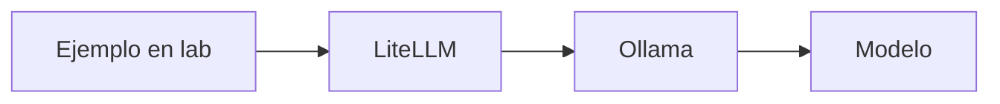

# Ejemplos de la demo LLM

Estos programas muestran, de forma progresiva, cómo una aplicación puede hablar con
un modelo, pedirle datos estructurados y darle acceso a herramientas. Están pensados
para personas que ya conocen programación, pero están empezando con LLM y agentes.

Los ejemplos son demostraciones, no aplicaciones preparadas para producción. La
respuesta del modelo puede cambiar entre ejecuciones y no debe darse por correcta
sin comprobarla.

## Antes de empezar

Desde la carpeta raíz del proyecto, arranca los servicios y espera a que termine
la descarga del modelo:

```bash
docker compose up -d
docker compose logs -f ollama-init
```

Pulsa `Ctrl+C` para dejar de ver los logs; esto no detiene los servicios. Ejecuta
los comandos siguientes también desde la raíz. `docker compose run --rm lab`
crea un contenedor temporal con las bibliotecas necesarias y lo elimina al acabar.
La primera vez puede necesitar construir la imagen `lab`.

El recorrido de una petición es:



LiteLLM ofrece una API compatible con OpenAI y presenta el modelo con el nombre
`miia-demo`; por defecto Ollama ejecuta `qwen3.5:2b-q4_K_M` en CPU. El ejemplo 06
también conecta con el servidor MCP. Los datos de los agentes están en
[`workspace/`](../workspace/).

### Conceptos útiles

- **Prompt y mensajes**: instrucciones y datos enviados al modelo. Los roles
  `system`, `user`, `assistant` y `tool` identifican su función en la conversación.
  - `system`: establece instrucciones generales para el comportamiento del asistente.
  - `user`: contiene la petición o los datos proporcionados por el usuario.
  - `assistant`: contiene la respuesta del modelo o una solicitud de herramientas.
  - `tool`: contiene el resultado que la aplicación devuelve tras ejecutar una herramienta.
- **Token**: fragmento de texto que procesa el modelo. No equivale necesariamente
  a una palabra; los caracteres y palabras pueden dividirse en varios tokens.
- **Contexto**: información que el modelo recibe en una petición, incluido el
  historial y las definiciones de herramientas.
- **Temperatura**: parámetro de muestreo. Valores bajos tienden a reducir la
  variación, pero no garantizan exactitud ni resultados idénticos.
- **Tool calling**: el modelo propone una llamada con un nombre y argumentos; es
  la aplicación, no el modelo, la que decide y ejecuta la operación.
- **Razonamiento**: algunos modelos generan contenido intermedio además de la
  respuesta. La configuración CPU de LiteLLM envía `think: false`. Los ejemplos
  añaden `/no_think`; `NO_THINK=0` elimina esa instrucción del texto, pero no
  cambia el `think: false` configurado en la pasarela.

### Configurar la API

Todos los ejemplos leen [`config.json`](config.json). Por defecto apunta a
LiteLLM en la red de Compose, con el modelo `miia-demo` y temperatura `0.0`:

```json
{
  "base_url": "http://litellm:4000/v1",
  "api_key": "${LITELLM_MASTER_KEY:-sk-demo-master}",
  "model": "miia-demo",
  "temperature": 0.0,
  "no_think": true
}
```

`api_key` admite una cadena literal o una referencia a una variable de entorno
completa, como `${NOMBRE}`. La forma `${NOMBRE:-valor}` usa el valor indicado
cuando la variable no existe. La clave de demostración no es un secreto real;
**no guardes claves reales en el archivo**. Si falta una variable necesaria o la
configuración es inválida, el programa informa del error y se detiene.

Para cambiar a una API externa compatible con OpenAI, edita `base_url`, `model`,
`temperature` y `no_think` en `config.json` y pon `api_key` como
`"${OPENAI_API_KEY}"`. Por ejemplo, con la API de OpenAI:

```json
{
  "base_url": "https://api.openai.com/v1",
  "api_key": "${OPENAI_API_KEY}",
  "model": "NOMBRE_DEL_MODELO_DISPONIBLE",
  "temperature": 0.0,
  "no_think": false
}
```

Facilita la clave sin escribirla en el historial del shell y pásala al contenedor:

```bash
read -rs -p "Clave API: " OPENAI_API_KEY; echo
export OPENAI_API_KEY
docker compose run --rm -e OPENAI_API_KEY lab python ejemplos/01_hola_api.py
unset OPENAI_API_KEY
```

En Windows usa el mecanismo equivalente de variables de entorno. `base_url` debe
incluir el prefijo de API esperado por el proveedor (a menudo `/v1`); `model` debe
ser un identificador disponible para tu cuenta. En ejecución directa fuera de
Docker, cambia la URL local a `http://localhost:4000/v1` o pasa
`OPENAI_BASE_URL=http://localhost:4000/v1`. Para apuntar a otro archivo montado
en el contenedor se puede usar `MIIA_CONFIG` con su ruta dentro del contenedor.

**Privacidad y costes:** con una API externa salen de tu equipo los prompts, el
contenido de los archivos que el agente lea, los resultados de herramientas y
otros datos de la conversación. Usa solo datos que estés autorizado a compartir y
ten en cuenta los costes y políticas del proveedor. No todos los modelos admiten
listado de modelos, streaming con estadísticas, `temperature`, JSON Schema o
tool calling; una API compatible puede rechazar alguna de estas opciones. Los
ejemplos no ocultan esos errores.

Las variables `OPENAI_BASE_URL`, `OPENAI_API_KEY` y `MODEL`, si están definidas,
tienen prioridad sobre el archivo; `NO_THINK=0` o `1` sobrescribe `no_think`.
Por ejemplo, para usar una clave virtual de LiteLLM en una sola ejecución:

```bash
docker compose run --rm -e OPENAI_API_KEY lab python ejemplos/01_hola_api.py
```

`MCP_URL` y `SANDBOX` siguen configurándose por separado en Compose. El archivo
fija una temperatura común de `0.0`; antes el ejemplo 01 usaba `0.2`.

Para comprobar todos los programas, ejecuta `./test-scripts.sh` desde la raíz.
El comprobador usa un sandbox y un servidor MCP temporales, muestra un resumen y
devuelve error si no se cumplen sus comprobaciones. Por la variabilidad del modelo,
un fallo puede ser que el agente no haya realizado la tarea, no solo un fallo Python.

## 01 · Peticiones y streaming

**Archivo:** [`01_hola_api.py`](01_hola_api.py)

```bash
docker compose run --rm lab python ejemplos/01_hola_api.py
```

**Objetivo:** entender cómo se usa una API de chat y qué significan algunas
métricas de inferencia.

1. Crea un cliente `OpenAI` apuntando a LiteLLM y lista los modelos visibles.
   Aunque se use esa biblioteca, la petición se envía a la pasarela local.
2. Construye dos mensajes: uno de sistema, que pide respuestas breves en español,
   y uno de usuario, que pregunta por la caché KV.
3. Envía una petición normal con `chat.completions.create`. Espera a recibir la
   respuesta completa y muestra el texto, el tiempo total y los tokens de entrada
   y salida declarados por la API.
4. Repite la petición con `stream=True`. En vez de esperar a la respuesta completa,
   imprime cada fragmento de texto según llega. Pide también estadísticas de uso;
   si no llegan, aproxima la salida contando fragmentos, no tokens reales.
5. Calcula el **TTFT** (*time to first token*), tiempo desde que se envía la
   petición hasta el primer fragmento con texto, y una velocidad aproximada de
   generación en tokens por segundo después de ese momento.

La caché KV guarda claves y valores de atención calculados para tokens anteriores
de la secuencia, para evitar volver a calcularlos en cada paso de generación.
El *prefill* procesa el contexto de entrada; el *decode* genera la salida paso a
paso. El TTFT incluye más que el prefill, por ejemplo red y colas. El programa
calcula tokens/s a partir de sus mediciones, no es un benchmark exhaustivo.
El primer uso también puede incluir la carga del modelo.

**Para experimentar:** cambia la pregunta o compara los tiempos de dos ejecuciones.
No interpretes una diferencia aislada como una comparación rigurosa de rendimiento.

## 02 · Concurrencia

**Archivo:** [`02_concurrencia.py`](02_concurrencia.py)

```bash
docker compose run --rm lab python ejemplos/02_concurrencia.py
docker compose run --rm lab python ejemplos/02_concurrencia.py 2
```

**Objetivo:** observar qué ocurre cuando llegan varias peticiones a la vez. Sin
argumento se lanzan ocho; con un entero se usa ese número.

El programa usa `AsyncOpenAI` y `asyncio.gather` para iniciar las peticiones sin
esperar secuencialmente a cada una. Cada petición pregunta por un dato de Granada,
con un máximo de 120 tokens de salida. Se imprime cuándo termina cada una y se
suman los tokens de salida informados por la API. El rendimiento agregado es esa
suma dividida entre el tiempo total; no es la velocidad de cada usuario.

En el Compose predeterminado Ollama tiene `OLLAMA_NUM_PARALLEL=2`: más peticiones
pueden tener que esperar. El resultado depende del modelo, contexto, hardware,
carga, caché y longitud de las respuestas. El perfil vLLM actual utiliza otro
modelo, así que compararlo directamente no aísla solo el efecto del motor.

## 03 · Extraer información como JSON

**Archivo:** [`03_salida_estructurada.py`](03_salida_estructurada.py)

```bash
docker compose run --rm lab python ejemplos/03_salida_estructurada.py
```

**Objetivo:** comparar pedir JSON en lenguaje natural con solicitar una salida
ajustada a un esquema.

El documento de entrada es un diploma inventado con errores de OCR: la lectura
automática de una imagen puede confundir letras, separar palabras o introducir
saltos. La clase `Diploma` de Pydantic define los campos y tipos esperados, como
`curso`, `alumno`, `horas` y `aprovechamiento`.

1. Primero se pide al modelo que responda solo con JSON, sin restricciones de
   formato por parte de la API. El programa imprime la respuesta y trata de
   validarla con `Diploma.model_validate_json`. Puede fallar, por ejemplo, si
   faltan campos, se incluyen nombres diferentes o el texto no es JSON válido.
2. Después genera un JSON Schema a partir de la clase Pydantic y lo envía en
   `response_format` con tipo `json_schema`. Si la pasarela y el motor soportan
   esta función, la generación se restringe al esquema solicitado.
3. La segunda respuesta se valida de nuevo con Pydantic y se imprime como JSON
   legible. Si la validación falla, el programa termina con error.

**Importante:** que un valor sea un `string` no demuestra que sea una fecha real
en formato `AAAA-MM-DD`: aquí ese formato se indica en la descripción, pero no se
valida como tipo fecha. Tampoco garantiza que los nombres o las horas extraídos
sean correctos. Las salidas estructuradas ayudan con el formato y los tipos;
para producción hacen falta validaciones y controles del contenido.

**Para experimentar:** cambia `TEXTO` o añade un campo a `Diploma` y compara
ambas respuestas. El campo con `Optional` acepta `null`, no implica por sí solo
que se pueda omitir.

## 04 · Una llamada a herramienta, paso a paso

**Archivo:** [`04_tool_calling.py`](04_tool_calling.py)

```bash
docker compose run --rm lab python ejemplos/04_tool_calling.py
```

**Objetivo:** ver la separación entre lo que propone el modelo y lo que hace el
programa.

1. Define la función Python `ects_desde_horas`: divide las horas entre 25 y
   redondea el resultado. Es una regla de ejemplo, no una consulta a un servicio.
2. Declara en `TOOLS` el nombre, la descripción y el esquema JSON de argumentos
   de la función. Esta descripción se envía al modelo; el código Python no.
3. Pregunta cuántos ECTS son 450 horas. El modelo puede devolver una o más
   `tool_calls`, cada una con un identificador, nombre y argumentos JSON.
4. El programa interpreta los argumentos con `json.loads`, ejecuta localmente la
   función y añade al historial la petición del asistente y un mensaje `tool` con
   el resultado y el `tool_call_id` correspondiente.
5. Envía de nuevo el historial al modelo, que redacta una respuesta final. Para
   450 horas, la función devuelve `18.0`.

Si el modelo responde sin pedir una herramienta, el programa lo indica y termina;
no debe confundirse esa salida con una prueba de tool calling exitosa. El ejemplo
es intencionadamente sencillo: en una aplicación real hay que comprobar nombres,
argumentos, permisos y errores antes de ejecutar acciones.

**Para experimentar:** cambia las horas o añade otra función y su esquema.
Comprueba siempre qué argumentos solicita el modelo y qué devuelve tu código.

## 05 · Agente con archivos, permisos y skills

**Archivo:** [`05_agente_minimo.py`](05_agente_minimo.py)

```bash
docker compose run --rm lab python ejemplos/05_agente_minimo.py
```

**Objetivo:** ampliar el tool calling a varias iteraciones para que el modelo
pueda consultar datos y pedir acciones hasta terminar una tarea.

La tarea predeterminada pide cargar la skill `informe-incidencias`, leer los
archivos de `workspace/incidencias` y escribir `workspace/informe.md`. El
programa comprueba que la skill se haya cargado y que se haya escrito contenido
en ese archivo; si no ocurre, termina con error.

1. El programa descubre las skills en `workspace/skills/*/SKILL.md`. Lee su nombre
   y descripción para incluirlos en el mensaje de sistema; su cuerpo se entrega
   cuando el modelo solicita `cargar_skill`.
2. Ofrece cuatro herramientas: `listar_directorio`, `leer_fichero`,
   `escribir_fichero` y `cargar_skill`.
3. El bucle común de [`agent_core.py`](agent_core.py) envía la tarea y las
   herramientas al modelo. Por cada llamada recibida interpreta los argumentos,
   ejecuta la función correspondiente y devuelve su resultado como mensaje
   `tool`. Repite hasta que el modelo responde sin llamadas o alcanza 12 pasos.
   Si una herramienta falla, el error se devuelve al modelo para que pueda intentar
   corregirse.
4. Antes de escribir, se solicita confirmación. Responde `s` para permitirlo;
   cualquier otra respuesta o ausencia de entrada lo deniega. Si se permite, el
   archivo puede crearse **o sobrescribirse**.

Las rutas se resuelven dentro del sandbox (`/workspace` en el contenedor); una
ruta que escape de él se rechaza. Esto no sustituye a un aislamiento y una
política de permisos adecuados en producción.

Para una tarea propia, pásala entre comillas:

```bash
docker compose run --rm lab python ejemplos/05_agente_minimo.py "Lista los archivos de incidencias"
```

Para omitir la confirmación y permitir escrituras dentro del sandbox:

```bash
docker compose run --rm lab python ejemplos/05_agente_minimo.py --auto
```

Usa `--auto` solo si aceptas que modifique archivos del sandbox. El comprobador
usa una copia temporal para no alterar tu `workspace`. La comprobación de la tarea
predeterminada verifica la carga de la skill y la escritura, **no** que el informe
esté bien ordenado o sea fiel a los datos: revísalo antes de utilizarlo.

## 06 · Agente con herramientas descubiertas por MCP

**Archivo:** [`06_agente_mcp.py`](06_agente_mcp.py)

```bash
docker compose run --rm lab python ejemplos/06_agente_mcp.py
```

**Objetivo:** usar el mismo bucle de agente del ejemplo 05, pero obtener las
herramientas desde un servicio externo mediante MCP (*Model Context Protocol*).

1. El cliente abre una sesión HTTP con el servidor MCP y la inicializa.
2. Consulta y muestra las herramientas, recursos y prompts disponibles. Los
   recursos son datos que el servidor expone y los prompts son plantillas;
   este ejemplo los lista, pero no los utiliza automáticamente.
3. Convierte el nombre, la descripción y el esquema de entrada de cada herramienta
   MCP al formato que la API de chat espera en `tools`.
4. Usa `run_agent` para enviar la tarea al modelo. Cuando este pide una herramienta,
   `dispatch` la llama en el servidor MCP y devuelve el resultado al modelo. Un
   error MCP se notifica al bucle para que el modelo pueda reaccionar.

La tarea predeterminada consulta las asignaturas de IoT, crea un ticket de
prioridad baja y lista los tickets. **Crea datos persistentes** en
`workspace/tickets.jsonl`; cada ejecución puede añadir otro ticket. Puedes pasar
una tarea propia, por ejemplo una consulta sin solicitar escrituras:

```bash
docker compose run --rm lab python ejemplos/06_agente_mcp.py "Consulta las asignaturas de IoT"
```

El modelo decide qué herramientas llamar y puede no completar la tarea. Las
pruebas automatizadas conectan con un MCP temporal para no crear tickets reales.
El servidor ofrece herramientas capaces de escribir, por lo que un prompt de
solo lectura no es una barrera de seguridad.

## Solución de problemas

- **No conecta con la API o MCP:** revisa `docker compose ps` y los logs de
  `litellm`, `ollama` y `mcp`. Asegúrate de que terminó `ollama-init`.
- **Es lento:** la primera petición puede cargar el modelo; en CPU, herramientas,
  salidas largas y varias peticiones simultáneas pueden tardar más.
- **No llama una herramienta o no completa el informe:** el modelo puede
  responder directamente, equivocarse con argumentos o agotar el límite de
  pasos. Consulta las líneas `[paso ...]`; no interpretes una afirmación del
  asistente como prueba de que una acción se ejecutó.
- **Esquema válido pero dato incorrecto:** revisa el documento de entrada y
  añade validaciones de negocio. La validación de JSON no comprueba por sí sola
  la veracidad del resultado.

La configuración completa y las opciones de GPU están en el
[README principal](../README.md).
